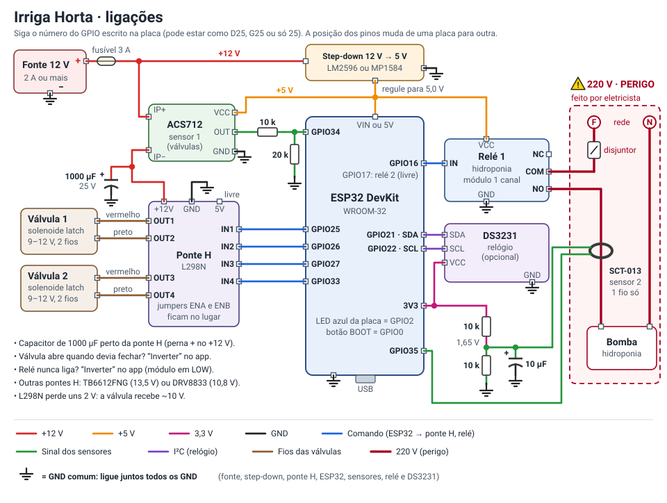

# Irriga Horta

Controlador de rega e hidroponia com ESP32, programado pelo celular por Bluetooth.

**App:** https://fernandofckc-del.github.io/irrigahorta/

## Sumário

1. [O que é](#1-o-que-é)
2. [Lista de material](#2-lista-de-material)
3. [Ligações](#3-ligações)
4. [Gravar o programa no ESP32](#4-gravar-o-programa-no-esp32)
5. [Colocar o app no ar e instalar no celular](#5-colocar-o-app-no-ar-e-instalar-no-celular)
6. [Primeiro uso](#6-primeiro-uso)
7. [Programar](#7-programar)
8. [Calibrar a corrente](#8-calibrar-a-corrente)
9. [Cuidados importantes](#9-cuidados-importantes)
10. [Problemas comuns](#10-problemas-comuns)
11. [Para quem for mexer no código](#11-para-quem-for-mexer-no-código)

---

## 1. O que é

O Irriga Horta é uma caixinha com um ESP32 que abre e fecha **duas válvulas de rega** e liga a
**bomba da hidroponia** nos horários que você escolhe. Você programa tudo pelo app **Irriga** no
celular, por Bluetooth, e vê a corrente elétrica na hora. Depois de programado, o controlador
trabalha sozinho. Não precisa de Wi-Fi nem de internet.

O que ele faz:

- **2 válvulas solenoide latch** (as de pulso, que gastam energia só para mudar de posição),
  com programação por **horário e dias da semana**.
- **Timer de hidroponia** por **ciclos** (liga X minutos, desliga Y minutos), com um ciclo para o
  dia e outro para a noite.
- Uma 4ª saída livre (relé 2) para luz, aerador etc.
- **Corrente em tempo real**: vê o pulso das válvulas e a corrente da bomba no app.
- **Alarmes**: válvula que não puxou corrente, bomba ligada sem corrente, corrente alta (pode
  desligar e bloquear a saída sozinho).
- **Histórico** do que ligou, desligou e dos alarmes.
- **Pausa de chuva**: segura a rega por algumas horas ou dias.
- Funciona **sem internet**: o app fica instalado no celular e fala direto com o controlador.

> [!IMPORTANT]
> Só funciona em celular **Android com o Chrome**. O iPhone (Safari ou Chrome) **não** tem
> Bluetooth para sites (Web Bluetooth), então o app não conecta no iPhone.

---

## 2. Lista de material

| Item | Qtd | Observação |
|---|---|---|
| ESP32-WROOM-32 DevKit (30 ou 38 pinos) | 1 | A placa comum "ESP32 DevKit V1". |
| Ponte H **L298N** | 1 | A mais fácil de achar. Perde uns **2 V** (com fonte de 12 V a válvula recebe ~10 V). Deixe os **jumpers ENA e ENB no lugar**. |
| *ou* ponte H **TB6612FNG** | 1 | Perde bem menos. Aguenta **até 13,5 V** no motor (VM). |
| *ou* ponte H **DRV8833** | 1 | Pequena. Aguenta **só até 10,8 V**: precisa de fonte de 9 V. |
| Válvula solenoide **latch** | 2 | 9 a 12 V DC, **2 fios** (vermelho e preto). |
| Fonte **12 V, 2 A ou mais** | 1 | Fonte de boa qualidade. |
| Step-down **LM2596** ou **MP1584** (12 V → 5 V) | 1 | Alimenta o ESP32, o relé e o ACS712. **Regule para 5,0 V antes de ligar o ESP32.** |
| Capacitor eletrolítico **1000 µF 25 V** | 1 | Nos bornes de +12 V e GND da ponte H. Ajuda no pulso das válvulas. |
| Módulo relé 1 canal | 1 ou 2 | Serve o comum de 5 V, de nível alto ou baixo. Com **jumper H/L**, deixe em **H**. Se ele aciona em nível baixo (LOW), ligue **"Inverter"** no app. Desligado, o pino fica solto e o relé não liga sozinho. |
| Sensor de corrente **ACS712 5 A** (sensor 1) | 1 | Mede o pulso das válvulas. Alimentado em 5 V. **Precisa do divisor** de 10 k + 20 k, porque a saída dele vai até 5 V e o ESP32 só aguenta 3,3 V. |
| Resistores **10 k** e **20 k** (1/4 W) | 1 de cada | Divisor do ACS712. |
| Sensor de corrente **SCT-013 com saída em tensão** (sensor 2) | 1 | Alicate que mede a corrente da bomba sem cortar fio. Compre o que tem "**1V**" na etiqueta (ex.: SCT-013-030 = 30 A / 1 V). Para bomba pequena prefira **SCT-013-005** ou **SCT-013-010** (veja a [seção 8](#8-calibrar-a-corrente)). |
| Resistores **10 k** | 2 | Polarização do SCT-013 (meio de 3,3 V = 1,65 V). |
| Capacitor eletrolítico **10 µF** (16 V ou mais) | 1 | Polarização do SCT-013. |
| Conector P2 fêmea (fone de ouvido) | 1 | Para o plugue do SCT-013 (ou corte o plugue). |
| Relógio **DS3231** (com bateria CR2032) | 1 | Opcional, mas **muito recomendado**: guarda a hora quando falta energia. Sem ele, depois de uma queda de energia o programa só volta quando o celular conectar. |
| Fusível 3 A com porta-fusível | 1 | No +12 V, logo na saída da fonte. |
| Disjuntor e DR 30 mA | 1 | Para a bomba em 220 V. Serviço de eletricista. |
| Caixa à prova d'água (IP65), prensa-cabos, bornes, placa perfurada, fios | — | Fio das válvulas: 0,5 mm² serve até uns 20 m. Mais longe, use 1,5 mm² (o pulso é forte e fio fino perde tensão). |

---

## 3. Ligações



*(Toque na imagem para ampliar.)*

### Pinos do ESP32

Estes pinos são fixos no programa. Na placa, o número pode estar escrito como `D25`, `G25` ou só `25`.

| Função | GPIO | Observação |
|---|---|---|
| Válvula 1 — lado A (IN1 da ponte H) | 25 | |
| Válvula 1 — lado B (IN2 da ponte H) | 26 | |
| Válvula 2 — lado A (IN3 da ponte H) | 27 | |
| Válvula 2 — lado B (IN4 da ponte H) | 33 | |
| Relé 1 — saída 3 (Hidroponia) | 16 | |
| Relé 2 — saída 4 (livre: luz, aerador…) | 17 | |
| Sensor de corrente 1 | 34 | ADC1, só entrada |
| Sensor de corrente 2 | 35 | ADC1, só entrada |
| I²C SDA (relógio DS3231, opcional) | 21 | |
| I²C SCL (relógio DS3231, opcional) | 22 | |
| LED de estado (LED azul da placa) | 2 | |
| Botão BOOT da placa | 0 | segurar 3 s = pausa da rega (só as válvulas) |

### 3.1 Energia

1. **Fonte 12 V** → **fusível 3 A** → é o seu "+12 V".
2. Do +12 V (depois do fusível) saem dois caminhos:
   - para a entrada do **step-down**;
   - para o **IP+ do ACS712** (o sensor 1 fica no caminho do +12 V da ponte H, veja 3.3).
3. **Step-down**: antes de ligar qualquer coisa nele, gire o parafusinho até o multímetro marcar
   **5,0 V** na saída. Depois ligue a saída 5 V em:
   - **VIN** (ou **5V**) do ESP32;
   - **VCC** do módulo relé;
   - **VCC** do ACS712.
4. **GND comum**: ligue juntos o − da fonte, o GND do step-down, o GND da ponte H, o GND do
   ESP32, os GND dos sensores, do relé e do DS3231. Sem isso nada funciona direito.

> [!NOTE]
> Dá para tirar 5 V da saída "5V" da L298N, mas só para teste na bancada: o regulador dela
> esquenta com o ESP32 e o relé, e a corrente do ESP32 passaria pelo sensor 1 (a leitura fica
> tremida). No campo, use o step-down.

### 3.2 Ponte H e válvulas

1. **+12V** da ponte H ← vem do **IP−** do ACS712. **GND** da ponte H ← GND comum.
2. **Capacitor de 1000 µF** bem perto dos bornes da ponte H: perna **+** (a mais comprida) no +12 V,
   perna **−** (lado da faixa) no GND. Capacitor ao contrário estoura.
3. **IN1** ← GPIO 25, **IN2** ← GPIO 26, **IN3** ← GPIO 27, **IN4** ← GPIO 33.
4. Deixe os **jumpers ENA e ENB** no lugar (na L298N).
5. **Válvula 1** em **OUT1** e **OUT2**: fio **vermelho no OUT1**, preto no OUT2.
6. **Válvula 2** em **OUT3** e **OUT4**: fio **vermelho no OUT3**, preto no OUT4.
7. Se uma válvula **abrir quando devia fechar**, não troque os fios: ligue **"Inverter"** daquela
   válvula no app (Ajustes → Saídas).

Usando outra ponte H:

- **TB6612FNG**: VM = +12 V (vindo do ACS712), VCC = 3,3 V do ESP32, **STBY, PWMA e PWMB no 3,3 V**.
  AIN1/AIN2 = GPIO 25/26, BIN1/BIN2 = GPIO 27/33. Válvula 1 em AO1/AO2, válvula 2 em BO1/BO2.
- **DRV8833**: só até 10,8 V, então use fonte de **9 V** (e válvulas de 9 V). IN1 a IN4 nos
  GPIO 25, 26, 27 e 33. Válvula 1 em OUT1/OUT2, válvula 2 em OUT3/OUT4. Se a plaquinha tiver
  pino SLP/EEP, ligue no 3,3 V.

### 3.3 Sensor 1: ACS712 (pulso das válvulas)

O ACS712 fica **em série no +12 V que alimenta a ponte H**. Assim ele mede o pulso das válvulas.

1. +12 V (depois do fusível) → **IP+**. **IP−** → +12V da ponte H.
2. **VCC** ← 5 V. **GND** ← GND comum.
3. **OUT** → resistor de **10 k** → **GPIO 34**.
4. Do GPIO 34 → resistor de **20 k** → GND.

> [!CAUTION]
> Nunca ligue o OUT do ACS712 direto no ESP32. Ele chega a 5 V e o ESP32 só aguenta 3,3 V.
> O divisor 10 k + 20 k resolve.

No app: sensor 1, **Modelo** "ACS712 5 A", **O que mede** = "**Pulso das válvulas**".

### 3.4 Relé e bomba (220 V)

1. Lado de baixa tensão do módulo: **IN** ← GPIO 16, **VCC** ← 5 V, **GND** ← GND comum.
2. Lado de 220 V: a **fase** passa pelo **disjuntor**, entra no **COM** do relé e sai do **NO**
   para a bomba. O **neutro** vai direto na bomba. O fio terra da bomba vai no terra da instalação.
3. Não use o borne **NC**.
4. Se o relé **nunca liga** quando o app manda ligar, o módulo aciona em nível baixo (LOW): ligue **"Inverter"** dessa saída no app.
   Desligado, o controlador deixa o pino **solto**, então o relé não liga sozinho quando a placa liga.

> [!WARNING]
> **220 V mata.** A parte da tomada, disjuntor, DR e bomba deve ser feita por quem entende de
> eletricidade. Use disjuntor e DR de 30 mA (bomba perto da água). Deixe o lado de 220 V separado
> e isolado do resto da placa.

O relé 2 (GPIO 17) é ligado do mesmo jeito, se você usar.

### 3.5 Sensor 2: SCT-013 (corrente da bomba)

O SCT-013 é um alicate: ele **abraça um fio só** da bomba (a fase **ou** o neutro). Se abraçar os
dois fios juntos, a leitura dá zero.

Ele precisa de uma "polarização" (um ponto de 1,65 V) feita com 2 resistores e 1 capacitor:

1. 3,3 V do ESP32 → resistor **10 k** → **ponto do meio** → resistor **10 k** → GND.
2. **Capacitor 10 µF** entre o ponto do meio (perna +) e o GND (perna −).
3. Um fio do SCT-013 → **ponto do meio**. O outro fio → **GPIO 35**. (Tanto faz qual fio vai onde.)

No app: sensor 2, **Modelo** do seu SCT-013, **O que mede** = "**Hidroponia**" (a saída da bomba).

### 3.6 Relógio DS3231 (opcional, recomendado)

- **VCC** ← **3,3 V** do ESP32 (não use 5 V aqui).
- **GND** ← GND comum.
- **SDA** ← GPIO 21. **SCL** ← GPIO 22.
- Coloque a bateria CR2032. Ligado em 3,3 V, o circuito de carga do módulo (o azul, ZS-042)
  praticamente não carrega a bateria, então pode usar a CR2032 comum.

### Antes de ligar na tomada

- [ ] Fusível no +12 V, logo na saída da fonte.
- [ ] Step-down medido: **5,0 V** na saída.
- [ ] Capacitor de 1000 µF com o + no +12 V.
- [ ] OUT do ACS712 passando pelo divisor (10 k + 20 k), nunca direto no ESP32.
- [ ] Todos os GND ligados juntos.
- [ ] Lado de 220 V isolado, com disjuntor e DR, conferido por eletricista.
- [ ] Nada de fio solto encostando na placa.

---

## 4. Gravar o programa no ESP32

Faça isso uma vez (e de novo quando sair versão nova do firmware). Dica: grave com a placa
solta, só no cabo USB, antes de montar tudo.

1. Instale a **Arduino IDE 2** (arduino.cc → Software).
2. Abra **Arquivo → Preferências** e, no campo **URLs adicionais para Gerenciadores de Placas**
   (em inglês: *Additional boards manager URLs*), cole:
   ```
   https://espressif.github.io/arduino-esp32/package_esp32_index.json
   ```
   Clique em OK.
3. Abra o **Gerenciador de Placas** (ícone de placa na barra da esquerda), procure **esp32** e
   instale **"esp32 by Espressif Systems"** (a versão mais nova, 3.x; a 2.0.x também funciona).
4. Abra o **Gerenciador de Bibliotecas** (ícone de livros), procure **ArduinoJson** e instale a
   de **Benoit Blanchon**, **versão 7**.
5. Baixe este projeto: no GitHub, botão verde **Code → Download ZIP**. Descompacte.
6. Na IDE: **Arquivo → Abrir** → `firmware/ControladorRega/ControladorRega.ino`.
7. Ligue o ESP32 no computador com um cabo USB **de dados** (cabo só de carga não serve).
8. **Ferramentas → Placa → esp32 → "ESP32 Dev Module"**.
9. **Ferramentas → Partition Scheme → "Huge APP (3MB No OTA/1MB SPIFFS)"**.
   O programa já ocupa uns 90% do espaço do esquema padrão ("Default"). Com o "Huge APP" sobra
   espaço e você não leva o erro "Sketch too big" numa atualização futura. Os ajustes e programas
   ficam guardados em outra área (NVS), que existe nos dois esquemas.
10. **Ferramentas → Porta** → escolha a porta da placa (COM3, COM4… no Windows; /dev/ttyUSB0 no Linux).
11. Clique em **Carregar** (seta →). Espere aparecer "Done uploading" / "Carregado".
    - Se ficar parado em `Connecting.....`, **segure o botão BOOT** da placa até começar a gravar.
12. Para ver as mensagens: **Ferramentas → Monitor Serial**, velocidade **115200**. Aparece a
    versão do firmware, a situação da hora e "Bluetooth pronto: Rega-XXXX".

> [!TIP]
> **A porta não aparece?** Instale o driver do chip USB da placa: **CP210x** (Silicon Labs) ou
> **CH340** (WCH). Olhe o chip perto do conector USB para saber qual é. Troque o cabo se mesmo
> assim não aparecer.

---

## 5. Colocar o app no ar e instalar no celular

### Publicar no GitHub Pages (uma vez)

O app fica na raiz do repositório `fernandofckc-del/irrigahorta`.

1. No GitHub, abra o repositório → **Settings** → **Pages**.
2. Em **Build and deployment → Source**, escolha **Deploy from a branch**.
3. Em **Branch**, escolha **main** e a pasta **/ (root)**. Clique em **Save**.
4. Espere mais ou menos 1 minuto. O endereço fica:
   **https://fernandofckc-del.github.io/irrigahorta/**

Na conta grátis do GitHub, o Pages só funciona com o repositório **público**.
Toda vez que você mandar arquivos novos para a branch `main`, o site se atualiza sozinho em 1 ou
2 minutos.

### Instalar no Android

1. Abra o endereço no **Chrome**.
2. Menu **⋮** → **Instalar app** (ou **Adicionar à tela inicial** → Instalar).
3. Aparece o ícone **Irriga** na tela do celular. Depois disso ele abre mesmo sem internet.

Permissões:

- Deixe o **Bluetooth ligado**.
- Na primeira vez que tocar em **Conectar**, o Chrome pede permissão de **Dispositivos por perto**
  (Android 12 ou mais novo) ou de **Localização** (Android 11 ou mais antigo). Toque em **Permitir**.
- No Android 11 ou mais antigo, a **Localização (GPS)** do celular também precisa estar ligada
  para achar o controlador.

Quando sair versão nova do app, aparece o aviso **"Versão nova do app"**. Toque em **Atualizar**.

---

## 6. Primeiro uso

1. Ligue o controlador. O LED azul pisca rápido: é normal, ele ainda não sabe a hora.
2. Abra o app → **Painel** → **Conectar**. Na lista, escolha o nome que começa com **Rega-**.
3. Pronto: o app **acerta a hora** do controlador sozinho, pelo relógio do celular.
   O fuso já vem como **Brasília (UTC−3)**. Se a horta fica em outro fuso (ex.: Manaus, Cuiabá), troque em
   **Ajustes → Fuso horário do controlador** e toque em **Enviar**.
   O LED fica **aceso** enquanto o celular está conectado.
4. Vá em **Ajustes**:
   - **Controlador**: troque o nome se quiser (aparece na lista do Bluetooth). Ponha um **PIN**
     se não quiser que qualquer um mexa.
   - **Saídas**: dê nomes que você entende ("Canteiro", "Pomar"). Desative o que não usa
     (ex.: Relé 2).
   - **Sensores de corrente**: ligue **Sensor ativo** só nos sensores que você montou.
     Sensor 1: Modelo "ACS712 5 A", O que mede "Pulso das válvulas", Mínimo 0,1 A.
     Sensor 2: Modelo do seu SCT-013, O que mede "Hidroponia".
   - Toque em **Enviar** na barra "Mudanças não enviadas". Nada é gravado sem o Enviar.
5. Com tudo desligado, vá em **Corrente** → **Zerar sensores**.
6. **Teste cada válvula**: no Painel, cartão da Válvula 1 → **Abrir por…** → **5 min**.
   Escute o clique, veja a água sair e olhe o **"Último pulso"** (corrente do pulso, em A).
   Depois toque em **Fechar**. Faça o mesmo com a Válvula 2.
   - Abriu ao contrário? **Ajustes → Saídas → Inverter** → Enviar.
7. **Teste a bomba**: cartão Hidroponia → **Ligar por…** → **5 min**. Veja a corrente na aba
   **Corrente**. Depois **Desligar**.
8. Vá em **Programas**, crie as regras (seção 7) e toque em **Enviar**.
9. Confira as faixas em **Hoje** e **Próximos 7 dias**.

---

## 7. Programar

Cada saída (Válvula 1, Válvula 2, Hidroponia, Relé 2) tem **até 8 regras**. A saída fica ligada
quando **qualquer** regra ativa manda ligar. Na aba **Programas**, escolha a saída e toque em
**+ Horário** ou **+ Ciclo**. Marque os dias da semana. No fim, **Enviar**.

### Horário fixo

Liga num horário, por um tempo. Campos: **Início**, **Duração** (1 a 1440 min) e dias.

**Exemplo — rega às 06:00 por 20 min, segunda, quarta e sexta:**
Programas → Válvula 1 → **+ Horário** → Início **06:00**, Duração **20** min → marque
**seg, qua, sex** → Enviar. Quer regar à tarde também? Crie outra regra: 17:30 por 15 min.

### Ciclo

Dentro de uma janela de horário, fica ligando e desligando. Campos: **Das**, **Às**,
**Liga** (min), **Desliga** (min) e dias.

- O ciclo **sempre começa ligado** no início da janela.
- **Desliga = 0** → fica ligado direto a janela toda.
- **Das** igual a **Às** → janela de 24 horas.

**Exemplo — hidroponia NFT: 15/15 de dia e 15/45 à noite:**
Programas → Hidroponia → botão **Usar "Dia 15/15 · Noite 15/45"**. Ou faça à mão:

| Regra | Das | Às | Liga | Desliga | Dias |
|---|---|---|---|---|---|
| Ciclo de dia | 06:00 | 19:00 | 15 | 15 | todos |
| Ciclo de noite | 19:00 | 06:00 | 15 | 45 | todos |

### Janela que passa da meia-noite

Vale o **dia em que começa**.

- Ciclo **das 22:00 às 02:00** marcado só na **sexta** → roda de sexta 22:00 até sábado 02:00.
- Horário **23:50 por 20 min** marcado no **sábado** → vai de sábado 23:50 até domingo 00:10.

> [!TIP]
> Se a água não tem pressão para as duas válvulas juntas, não deixe os horários se encostarem.
> O app avisa quando as duas abrem ao mesmo tempo.

### Manual

No **Painel**, cada saída tem:

- **Abrir por… / Ligar por…** → 5, 10, 15, 30 min, 1 h, 2 h ou outro tempo (até 24 h).
  Depois do tempo, **volta sozinho ao programa**.
- **Fechar / Desligar** → se o programa está mandando ligar agora, fica desligado até a próxima
  mudança do programa (no máximo 24 h). Senão, só desliga.
- **Voltar ao programa** → cancela o manual.

O manual não fica gravado: se faltar energia, ele se perde e o controlador volta ao programa.

### Pausa de chuva

No Painel, **Pausar a rega (chuva)** → 6, 12, 24, 48 ou 72 h (ou outro tempo, até 30 dias).
As **duas válvulas** param de abrir pelo programa. **A hidroponia continua.**
Se uma válvula já estava pausada por mais tempo (ex.: 3 dias de manutenção), ela continua com a pausa mais longa.
Para cancelar, toque de novo (**Cancelar pausa da rega**).

- Cada saída também tem o seu botão **Pausar…** no Painel.
- A pausa **fica gravada**: continua valendo mesmo se faltar energia.
- Durante a pausa você ainda pode abrir à mão (Abrir por…).

### Bloqueio por corrente alta e alarmes

Num sensor que vigia uma saída (ex.: sensor 2 → Hidroponia):

- **Mínimo**: ligada há 5 s e a corrente fica abaixo disso por 3 s → alarme "ligada sem corrente"
  (bomba fora da tomada, disjuntor desarmado, relé com defeito).
- **Máximo**: corrente acima disso por 2 s → alarme "corrente alta".
- **Cortar se passar** ligado → além do alarme, a saída **desliga e fica bloqueada**
  ("Bloqueada: corrente alta"). O bloqueio **fica gravado** (vale mesmo depois de faltar energia).
  Para soltar: botão **Liberar** no cartão da saída (ou **Ligar por…**).

No sensor das válvulas (Pulso das válvulas), o **Mínimo** dá o alarme "pulso sem corrente":
a válvula foi mandada mudar, mas não passou corrente (fio solto, fusível queimado, válvula ruim).

Os alarmes aparecem no Painel e no **Histórico**.

### Histórico

O controlador guarda os **últimos 200 eventos** na memória (perde se faltar energia). O app
guarda tudo o que recebeu. Na aba **Histórico**, toque em **Atualizar** para buscar os novos.

### Botão BOOT (sem celular)

**Segure o botão BOOT da placa por 3 segundos:**

- se nenhuma válvula estiver pausada → **pausa a rega das duas válvulas por 24 h**;
- se alguma válvula estiver pausada → **cancela a pausa das válvulas**.

A **hidroponia e o relé 2 continuam no programa**: a bomba nunca para pelo botão (24 h sem bomba
pode matar as plantas numa NFT). O botão é bom para uma chuva forte quando você está longe do
celular, ou para mexer nos canos da rega. No Histórico aparece "pausada por 24 h pelo botão do controlador".

### LED azul da placa

| LED | Quer dizer |
|---|---|
| Aceso direto | Celular conectado. |
| Piscando rápido | **Sem hora certa**: o programa **não liga nada**. Conecte o app para acertar. |
| Piscada curta a cada 3 s | Normal, trabalhando sozinho. |

---

## 8. Calibrar a corrente

1. **Zerar**: com **tudo desligado**, aba **Corrente** → **Zerar sensores**. (O controlador também
   zera sozinho toda vez que liga.) Se alguma saída estiver ligada, ele recusa e avisa.
2. **Bomba (SCT-013)**: ligue a bomba e meça com um **alicate amperímetro** no mesmo fio.
   Se o app e o alicate não baterem, ajuste o **Ajuste fino** do sensor:
   **Ajuste fino = valor do alicate ÷ valor do app** (de 0,5 a 2).
   Ex.: app mostra 0,40 A, alicate mede 0,44 A → 0,44 ÷ 0,40 = **1,1**.
3. **Válvulas (ACS712)**: o pulso é rápido demais para o multímetro. Faça a conta:
   solte os fios da válvula, meça a **resistência da bobina** e calcule
   **corrente ≈ (12 − 2) ÷ resistência** (o "− 2" é a perda da L298N; com a TB6612FNG, use
   12 ÷ resistência).
   Ex.: bobina de 8 Ω → uns 1,2 A. Se o "Último pulso" der perto disso (30% para mais ou para
   menos), está bom. Aqui a precisão não importa muito: o que vale é ver se o pulso aconteceu.

Valores comuns:

| O quê | Corrente típica |
|---|---|
| Pulso de válvula latch 9–12 V | 0,3 a 2 A (por uma fração de segundo) |
| Bomba pequena de hidroponia em 220 V (20 a 100 W) | 0,1 a 0,5 A |
| Nada ligado | 0 (depois de zerar) |

**Correntes pequenas:** o SCT-013-030 é "grosso" para bomba pequena: 0,2 A dá só uns 7 mV, perto
do ruído do ESP32, e a leitura fica pulando ou mostra 0. Saídas:

- use **SCT-013-005** (5 A) ou **SCT-013-010** (10 A); ou
- passe o fio **várias voltas** pelo alicate. A corrente lida fica multiplicada pelo número de
  voltas. No app, escolha Modelo **Personalizado** e ponha **mV por A = (mV por A do seu modelo) ×
  número de voltas**. Ex.: SCT-013-030 (33,3 mV/A) com 5 voltas → **166,5 mV/A**.

Sugestão de limites para a bomba: **Mínimo** ≈ metade da corrente normal, **Máximo** ≈ 1,5 vez a
corrente normal, e **Cortar se passar** ligado.

---

## 9. Cuidados importantes

> [!WARNING]
> **A válvula latch fica onde estava quando falta energia.** Se faltar energia com a válvula
> **aberta** e a água com pressão, **continua regando** até a energia voltar.

- Quando a energia volta, o controlador **fecha as duas válvulas** logo ao ligar, e depois segue
  o programa.
- Com o **DS3231**, ele sabe a hora assim que a energia volta. **Sem o DS3231, o programa fica
  parado** até o celular conectar (LED piscando rápido).
- Para regas grandes, pense em um **nobreak ou bateria de 12 V** para a fonte, e deixe um
  **registro manual** antes das válvulas.
- **220 V**: feito por quem entende, com **disjuntor**, **DR 30 mA** e **fio terra** na bomba.
  Lado de 220 V longe da parte de 3,3/5/12 V.
- Eletrônica numa **caixa fechada e seca** (IP65), com **prensa-cabos**, longe do sol direto e de
  respingos. Faça uma "barriga" no fio antes de entrar na caixa para a água não escorrer para dentro.
- **Teste antes de deixar sozinho**: deixe rodar um dia inteiro olhando, e confira o Histórico.
- Ponha um **PIN** se outras pessoas chegam perto do controlador com celular.

---

## 10. Problemas comuns

| Problema | O que fazer |
|---|---|
| **App não acha o controlador** | Bluetooth do celular ligado. Permissão "Dispositivos por perto" (ou Localização + GPS ligado no Android 11 ou mais antigo). Use o **Chrome**. Chegue perto. Só **um celular por vez**: desconecte o outro. Veja se o LED da placa pisca (está ligada?). Abra o Monitor Serial e veja se aparece "Bluetooth pronto". |
| **Pede PIN** | Alguém pôs PIN em Ajustes. Digite o PIN. Depois de 5 erros seguidos ele desconecta e **só aceita PIN de novo depois de 60 s** (o app mostra a contagem). Esqueceu? Grave o firmware de novo com **Ferramentas → Erase All Flash Before Sketch Upload → Enabled**: isso **apaga todos os ajustes e programas** e tira o PIN. Depois volte a opção para Disabled. |
| **Válvula não mexe / alarme "pulso sem corrente"** | Confira o fusível e os 12 V na ponte H. Confira os fios OUT e os jumpers ENA/ENB. Válvula de 12 V com L298N recebe só ~10 V: se não mexer, aumente o **Pulso da válvula** (Ajustes → Controlador) para 120, 150 ou 200 ms. Teste com "Abrir por…". |
| **Válvula abre ao contrário** | Ajustes → Saídas → aquela válvula → **Inverter** → Enviar. |
| **Relé nunca liga** | O módulo aciona em nível baixo (LOW): Ajustes → Saídas → **Inverter** → Enviar. Confira também o VCC (5 V) e o GND do módulo. |
| **Relé ligado o tempo todo** | Com o pino solto ele devia desligar. Veja se o fio IN não encostou em GND e se o jumper H/L está certo; teste o módulo ligando o IN direto em 3,3 V e em GND. |
| **Hora errada / LED piscando rápido** | Conecte o app: ele acerta a hora. Se perde a hora toda vez que falta energia, instale o **DS3231** (ou troque a bateria dele). Confira **Ajustes → Fuso horário do controlador**. Se o app avisa que o relógio do celular está errado, acerte a data do celular. |
| **Corrente mostra valor sem nada ligado** | Desligue tudo e toque em **Zerar sensores**. Sensor que não está montado: desligue **Sensor ativo** (pino solto lê lixo). Confira o divisor (ACS712) e a polarização (SCT-013). |
| **Corrente da bomba sempre 0** | SCT abraçando os dois fios? Abrace um só. Bomba pequena com SCT-013-030? Veja a [seção 8](#8-calibrar-a-corrente). |
| **"Sketch too big" ao gravar** | Ferramentas → Partition Scheme → **Huge APP (3MB No OTA/1MB SPIFFS)**. |
| **Gravação parada em "Connecting…"** | Segure o botão **BOOT** até começar. |
| **iPhone** | Não funciona: o iPhone não tem Bluetooth para sites. Use um celular Android com Chrome. |

---

## 11. Para quem for mexer no código

O contrato entre o firmware e o app está em [`docs/PROTOCOLO.md`](docs/PROTOCOLO.md): pinos,
Bluetooth, mensagens, regras de programação e limites. Qualquer mudança vale para os dois lados.
O firmware fica em `firmware/ControladorRega/` (a lógica em `nucleo.h` e `agenda.h`, em C++ puro;
o `.ino` só liga ao hardware). O app é `index.html` + `agenda.js` na raiz. Os testes ficam em
`testes/`: o núcleo do firmware roda no PC sem placa com
`testes/nativo/compila.sh && node testes/nativo/testa.cjs` (precisa de g++ e Node), e o app é
testado de ponta a ponta com Bluetooth de mentira (`testes/ble-falso.js`) ligado a esse mesmo
núcleo, com `NODE_PATH=$(npm root -g) node testes/e2e-falso.cjs` (precisa do Playwright com Chromium).
